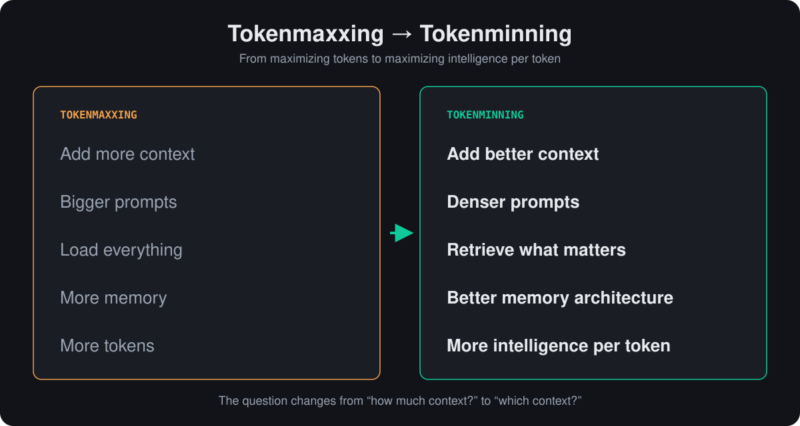
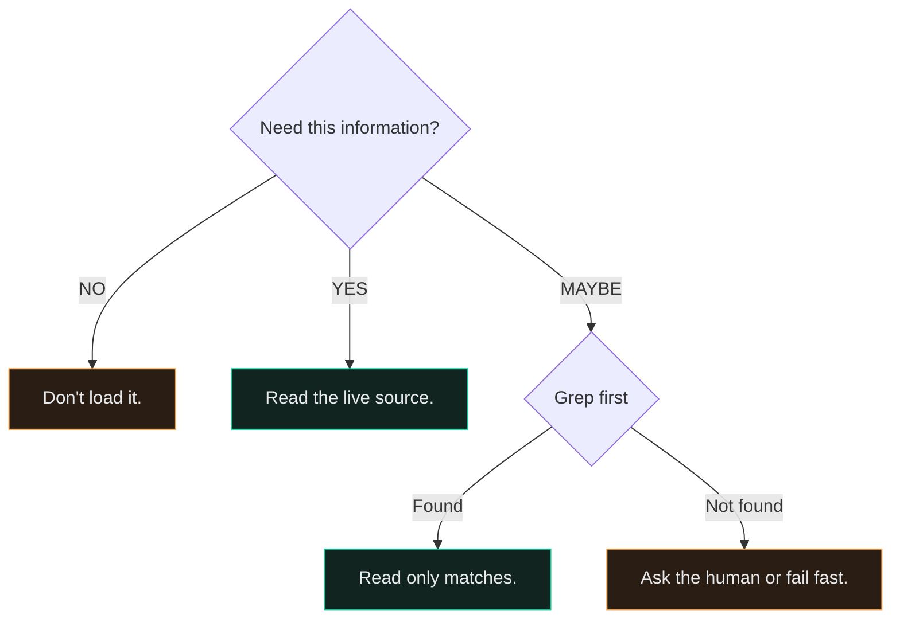
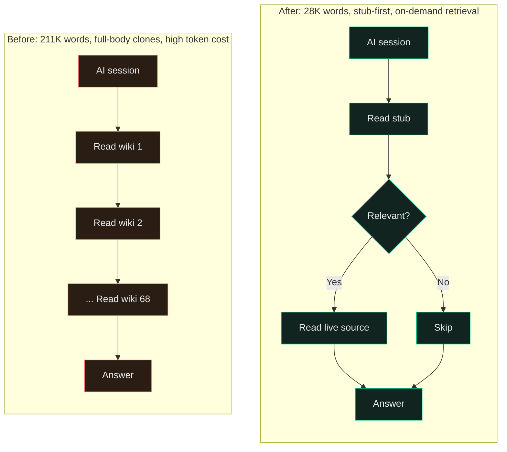
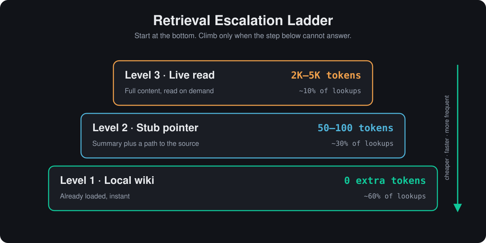

# Tokenminning

<p align="center">
  
</p>

<p align="center">
  <strong>Maximize intelligence per token</strong>
  <br/>
  <em>Not by minimizing tokens, but by delivering the right context at the right time</em>
</p>

<p align="center">
  <a href="https://github.com/zwolf25/tokenminning/stargazers"></a>
  <a href="https://github.com/zwolf25/tokenminning/commits/main"></a>
  <a href="https://github.com/zwolf25/tokenminning/commits/main"></a>
  <a href="LICENSE"></a>
  <a href="https://github.com/zwolf25/tokenminning/pulls"></a>
  <a href="https://medium.com/@zwolf25"></a>
</p>

<p align="center">
  <a href="#case-studies">Case Studies</a> •
  <a href="#principles">Principles</a> •
  <a href="#techniques">Techniques</a> •
  <a href="#real-world-results">Results</a> •
  <a href="CONTRIBUTING.md">Contributing</a> •
  <a href="https://medium.com/@zwolf25">Articles</a>
</p>

> 🆕 **What's New:** [v0.9.3](https://github.com/zwolf25/tokenminning/releases/tag/v0.9.3) — a smaller README (case studies as one table), an Evidence column on every results table, and a runnable Quick Start. Previously: [v0.9.2](https://github.com/zwolf25/tokenminning/releases/tag/v0.9.2); [full changelog](CHANGELOG.md).

---

## Why Tokenminning?

| Tokenmaxxing | Tokenminning |
|:---|:---|
| "How do I give the model **more** context?" | "How do I give the model the **right** context?" |
| Add more context | Add **better** context |
| Bigger prompts | **Denser** prompts |
| Load everything | **Retrieve what matters** |
| More memory | **Better memory architecture** |
| More tokens | **More intelligence per token** |

> **Tokenminning is not:** minimizing tokens to cut costs, aggressively shortening prompts, removing useful context, or avoiding large context windows.
>
> **Tokenminning is:** improving information density, eliminating context debt, and designing systems where the right context arrives at the right time.



---

## Quick Start

Tokenminning is a design philosophy; the tools here measure it on your own setup. Three steps, about five minutes:

```bash
git clone https://github.com/zwolf25/tokenminning && cd tokenminning

# 1. Audit what loads every session (stdlib Python, read-only, never writes)
python3 tools/lint/claude-md-lint.py

# 2. Read the output: resident size in chars and ~tokens, dangling @imports, duplicated blocks.
# 3. Apply one trim (delete a duplicate or an @import you never use), then re-run step 1.
```

**Then:** read the [Principles](#principles), pick a [Case Study](#case-studies), and apply one technique.

---

## Principles

| # | Principle | One-Liner |
|:---:|:---|:---|
| 1 | **🔍 Retrieve, don't preload** | Supply relevance on demand |
| 2 | **🗜️ Compress, don't repeat** | Cut redundant instructions & history |
| 3 | **📋 Structure, don't narrate** | Prefer structured data over prose |
| 4 | **🎯 Spend tokens where reasoning matters** | Allocate budget to high-value thinking |
| 5 | **🏗️ Design systems, not prompts** | Architecture (retrieval, tools, memory) drives savings |
| 6 | **⚙️ Optimize context, not complexity** | "What does the model need right now?" |
| 7 | **🧹 Eliminate context debt continuously** | Audit memories, routing, config like production code |


*Default: don't load unless justified.*

> [!NOTE]
> These principles emerged from production Second Brain workflows at ServiceChannel, not theoretical speculation.

---

## Techniques

| Technique | Description | Case Study |
|:---|:---|:---|
| **Stub Pattern** | Replace full clones with `summary + source-path` pointers | [Second Brain](examples/second-brain-system.md) |
| **Grep-before-read** | Never read a folder wholesale; search first | [Config Audit](examples/second-brain-config-audit.md) |
| **Escalation Ladder** | Level 1: local cache → Level 2: stub lookup → Level 3: on-demand read | [All] |
| **Compaction** | Keep active context ≤ 15K tokens | [Wiki Pipeline](examples/wiki-pipeline.md) |
| **Thin Routers** | Startup instructions = behavior/routing only; retrieve details on demand | [Config Audit](examples/second-brain-config-audit.md) |
| **Trim Resident Context** | Remove always-loaded text that is injected elsewhere, duplicated, or rarely needed | [CLAUDE.md Trim](examples/claude-md-context-trim.md) · [Try it](tools/lint) |
| **Single Source of Truth** | Store durable knowledge once, reference everywhere | [All] |
| **Deterministic Pre-filter** | Run a zero-dep script first; model only judges flagged items | [Wiki Lint](examples/vault-lint-case-study.md) · [Try it](tools/lint) · [Visual Validation](examples/visual-validation-pipeline.md) · [Try it](tools/visual-diff) |
| **Zero-Token Content Processing** | Convert binary (PDF/DOCX/VTT) locally via subprocess; model only sees file path | [Doc Pipeline](examples/document-processing.md) · [Try it](tools/doc-convert) |
| **Schema-Enforced Extraction** | Rigid output schema (7 categories) forces structured data; no prose summaries | [Doc Pipeline](examples/document-processing.md) |
| **Failure-Mode Driven Escalation** | Each ladder level has documented failure mode → next level; no guessing | [Web Ladder](examples/web-scraping-escalation.md) |
| **Contract-Driven Tool Discipline** | Versioned SKILL.md contracts enforce token rules, routing, composition by design | [Skill System](examples/skill-tooling-pattern.md) |

---

## Real-World Results

Evidence column: **measured** = counted from real data; **estimated** = derived with stated assumptions; **single run** = one observation. The data behind these is private; each case study states its method and caveats, and B-002 in the [backlog](BACKLOG.md) tracks making them re-checkable.

| Metric | Before | After | Change | Evidence |
|:---|:---:|:---:|:---:|:---:|
| **Second Brain wiki words** | 211K | 28K | **87% ↓** | measured |
| **Wiki pipeline cost/run** | $50+ (11 agents) | $15–25 (2–3 agents) | **~70% ↓ cost, 80% ↓ agents** | single run |
| **CLAUDE.md size** | ~48.6 KB | 34.4 KB | **29% ↓ (~3,500 tokens/session)** | measured (bytes); tokens estimated |
| **Stale sync clones** | 66% | 0% | **100% eliminated** | measured |
| **RTK adoption gap** | 94% commands bypassed | → upstream fix | **1.5M tokens/30d recovered** | estimated |
| **Wiki lint pre-filter (this repo)** | 8.5M tokens/run | ~1.2M est. | **~86% ↓** | estimated |
| **Long-session cost per turn** | 2.1x at 250k context, 4–5x at 500k+ | `/compact` at ~250k | **59% of one model's spend was above the knee** | measured (rate ratios assumed) |
| **Always-loaded CLAUDE.md context** | 32,157 B (~8K tokens) | 25,365 B | **~21% ↓ (~1.7K tokens/session, chars/4 est.)** | measured (bytes); tokens estimated |
| **Untracked spend** | 44% of spend in sessions with no task id | `/todos <id>` at session start | **Cost now has an owner** | measured |

> [!NOTE]
> These come from production Second Brain workflows, not synthetic benchmarks, except Case Study 10, which is labeled synthetic.

---

## Tooling Measured Results

*Production skill stack figures (from Case Studies 6–8). Token counts for these are author estimates; the case studies do not state a sample size.*

| Workflow | Before (Prompt-Based) | After (Skill System) | Improvement | Evidence |
|:---|:---:|:---:|:---:|:---:|
| **50-page PDF → Wiki** | ~80K tokens, manual | ~500 tokens, automated | **99.4% ↓** | estimated |
| **2-hr VTT → Decisions** | ~45K tokens, error-prone | ~300 tokens, schema-enforced | **99.3% ↓** | estimated |
| **Competitor research (10 sites)** | ~500K tokens, ad-hoc | ~5K tokens, ladder + cache | **99% ↓** | estimated |
| **Market research report** | $50+, 11 agents, manual | $15-25, 2-3 agents, pipeline | **~70% cost ↓** | single run |
| **Context debt (stale clones)** | 66% of files | 0% (fingerprint dedup) | **Eliminated** | measured |
| **Prompt drift / repeated instructions** | Re-prompt every task | Contract loaded once | **Observed, not measured** | qualitative |
| **Tool usage consistency** | Varies by person | Set by the skill contract | **Observed, not measured** | qualitative |
| **New capability onboarding** | Hours (re-teach via prompt) | Minutes (install → auto-routes) | **Observed, not timed** | qualitative |

---

## Case Studies

One row each; the full problem, fix, result and caveats live in the linked file.

| # | Case study | Result | Links |
|:-:|:---|:---|:---|
| 1 | **Second Brain** | 87% fewer words (211K → 28K), 66% → 0% stale clones | [Read](examples/second-brain-system.md) |
| 2 | **RTK & LLMLingua Evaluation** | Found a 1.5M tokens/30d adoption gap; kept RTK, rejected LLMLingua | [Read](examples/rtk-llmlingua-evaluation.md) |
| 3 | **Config & Memory Audit** | 29% smaller CLAUDE.md, ~3,500 tokens/session | [Read](examples/second-brain-config-audit.md) · [Try it](tools/lint) |
| 4 | **Wiki Pipeline** | $50 → $15/run, 11 → 2–3 agents | [Read](examples/wiki-pipeline.md) |
| 5 | **Wiki Lint** | 90 → 13 mechanical findings, ~86% fewer tokens (estimated) | [Read](examples/vault-lint-case-study.md) · [Try it](tools/lint) |
| 6 | **Document Processing Pipeline** | ~99% fewer tokens via local subprocesses (estimated) | [Read](examples/document-processing.md) |
| 7 | **Web Scraping Escalation Ladder** | 7-level fallback from API credits to free local tools | [Read](examples/web-scraping-escalation.md) |
| 8 | **Skill Tooling Pattern** | Skills as versioned contracts; qualitative, not measured | [Read](examples/skill-tooling-pattern.md) |
| 9 | **Honey/eso CCR Evaluation** | 92% array compression; two reversals | [Read](examples/honey-eso-ccr-evaluation.md) |
| 10 | **Pixel-Diff Screenshot Validation** | 74–99% fewer tokens on 30 synthetic cases | [Read](examples/visual-validation-pipeline.md) |
| 11 | **Derived-Document Staleness** | 6 false flags silenced (~516K tokens), 2 lossy refreshes blocked | [Read](examples/derived-doc-staleness.md) · [Try it](tools/derived-stale) |
| 12 | **Context-Length Threshold** | ~2.1x cost per turn at 250k, ~4–5x at 500k+ | [Read](examples/context-length-threshold.md) · [Try it](tools/context-threshold) · [Status line](tools/statusline) |
| 13 | **Cost Attribution to Tasks** | 44% of spend had no task id | [Read](examples/cost-attribution-to-tasks.md) · [Try it](tools/cost-by-task) |
| 14 | **Trimming Always-Loaded Context** | ~21% less resident context (32,157 → 25,365 B) | [Read](examples/claude-md-context-trim.md) · [Try it](tools/lint) |
| 15 | **Incremental Wiki Refresh** | Hash gate + diff-first folding; 14 of 21 pages were noise | [Read](examples/incremental-wiki-refresh.md) |

---

## Technique Guides

Practical applications of tokenminning to specific systems:

| Guide | Focus |
|-------|-------|
| [Claude Code & `CLAUDE.md`](examples/claude-code.md) | Keep config focused; retrieve on demand |
| [Context-Length Threshold](examples/context-length-threshold.md) · [Try it](tools/context-threshold) | Measure cost per turn vs context size; compact at the knee (~250k here) |
| [Skill Usage](examples/skill-tooling-pattern.md#measuring-skill-usage) · [Try it](tools/skill-usage) | Log skill calls; find installed skills that load every session but are never used |
| [Evaluate Before Adopting](examples/evaluate-before-adopting.md) · [Try it](tools/retrieval-gaps) | Count real retrieval misses in your transcripts before installing a search tool; ours was 0 in 3,306 messages |
| [Cost Attribution to Tasks](examples/cost-attribution-to-tasks.md) · [Try it](tools/cost-by-task) | Join transcript cost to task ids; 44% of spend was untracked |
| [Context Debt](examples/context-debt.md) | Stale, duplicated, or always-loaded context that costs tokens without paying back |
| [MCP / Tool Scoping](examples/mcp.md) | Load capabilities only when workflow needs them |
| [Memory Systems](examples/memory.md) · [Try it](tools/memory-template) | Preserve decisions/constraints, not transcripts |
| [RAG Pipelines](examples/rag.md) | Rank → filter → focus; quality over quantity |
| [Local Document Pipeline](examples/document-processing.md) | Zero-token binary→markdown→structured extraction |
| [Web Scraping Escalation](examples/web-scraping-escalation.md) | 7-level ladder: credits → cache → free local → browser |
| [Skill System as DSNP](examples/skill-tooling-pattern.md) | Versioned contracts, thin router, composable |
| [All Examples Index](examples/index.md) | Quick reference for all patterns |

> These are *technique guides* — not measured case studies. Case studies in `examples/` (`second-brain-system.md`, etc.) show before/after metrics.

---

## How It Works

Tokenminning operates on a simple **escalation ladder** — the model only sees what it needs, when it needs it:

```
┌─────────────────────────────────────────────────────────────┐
│  LEVEL 1: LOCAL CACHE                                       │
│  Hot context, recent decisions, active task state           │
│  → Always loaded, ≤ 2K tokens                               │
├─────────────────────────────────────────────────────────────┤
│  LEVEL 2: STUB LOOKUP                                       │
│  Summary + source-path pointers to durable knowledge        │
│  → Loaded on reference, ~500 tokens each                    │
├─────────────────────────────────────────────────────────────┤
│  LEVEL 3: ON-DEMAND READ                                    │
│  Full source content retrieved only when explicitly needed  │
│  → Lazy, precise, unbounded depth                           │
└─────────────────────────────────────────────────────────────┘
```

**The key insight:** Most systems preload Level 3. Tokenminning makes Level 1 the default, Level 2 the bridge, Level 3 the exception.




---

## Related Projects

| Project | Description | Relation |
|:---|:---|:---|
| **[RTK](https://github.com/rtk-ai/rtk)** | Rust CLI proxy for tool-output compression (60-90% savings) | Complementary — handles command output; tokenminning handles context architecture |
| **[Caveman](https://github.com/JuliusBrussee/caveman)** | Terse communication mode (65% fewer output tokens) | Sibling — reduces prompt verbosity; tokenminning reduces context surface |
| **[Ponytail](https://github.com/DietrichGebert/ponytail)** | YAGNI code generation philosophy (~54% less code) | Sibling — reduces implementation bloat; tokenminning reduces context bloat |
| **[GPTCache](https://github.com/zilliztech/GPTCache)** | Semantic caching for LLM APIs | Different layer — caches model responses; tokenminning optimizes what reaches the model |
| **[Firecrawl](https://github.com/mendableai/firecrawl)** | Web search/scrape API — search, scrape, crawl, monitor, interact | **Levels 1–3** of the escalation ladder (credits, cache, scheduled monitors) |
| **[Scrapling](https://github.com/Scrapling/Scrapling)** | Free local HTTP + stealth browser (Cloudflare bypass) | **Levels 4–5** of the ladder (credits exhausted, anti-bot pages) |
| **[markitdown](https://github.com/microsoft/markitdown)** | Universal document converter (PDF, DOCX, XLSX, PPTX, HTML, images) | `doc-convert` **fallback engine** for scanned/image-heavy formats |
| **[Headroom](https://github.com/headroomlabs-ai/headroom)** | Open-source context compression layer for AI agents (60-95% fewer tokens for JSON, 15-20% coding agents) | Complementary — compresses context that reaches the model; tokenminning selects/retrieves better context |
| **[Honey (honey-for-devs)](https://github.com/green-pt/honey-for-devs)** | Cross-tool coding skill merging YAGNI/terse-prose modes with 3 novel pieces (ESON, CCR, honey-usage) | Sibling — CCR's array-compression idea was evaluated and partially adopted; RTK/caveman/ponytail already covered the rest ([case study](examples/honey-eso-ccr-evaluation.md)) |
| **[base (basemode)](https://github.com/ChristopherKahler/base)** | Rust CLI — tree-sitter code graph + Claude Code hooks injecting context at session-start/prompt/tool-use | Different mechanism — graph-derived injection via hooks instead of stub pointers; no published token deltas, unverified against tokenminning's own measured-savings bar |

---

## Contributing

We welcome real-world examples, counterexamples, benchmarks, and tool-specific patterns.

1. **Case studies** — Add to `examples/` as `<kebab-name>.md`
2. **Techniques** — Document patterns in `examples/` too
3. **Counterexamples** — Where tokenminning *doesn't* apply (valuable!)
4. **Tool patterns** — Claude Code, Cursor, Codex, Continue, etc.

See [CONTRIBUTING.md](CONTRIBUTING.md) for details, and [BACKLOG.md](BACKLOG.md) for planned work.

---

## Star History

<a href="https://www.star-history.com/?repos=zwolf25%2Ftokenminning&type=date&legend=top-left">
 <picture>
   <source media="(prefers-color-scheme: dark)" srcset="https://api.star-history.com/chart?repos=zwolf25/tokenminning&type=date&theme=dark&legend=top-left&sealed_token=BBCppQ67mTa4wI5rBMGBoHAaX4Fxr2SsMs40OSQKRCC_ID7tfQjRuh7312IPHSbhT2E9RkqzBv3LszM73nygwCxRC44cn0MLz3av3yVGGNj84-7zQAi-Kw" />
   <source media="(prefers-color-scheme: light)" srcset="https://api.star-history.com/chart?repos=zwolf25/tokenminning&type=date&legend=top-left&sealed_token=BBCppQ67mTa4wI5rBMGBoHAaX4Fxr2SsMs40OSQKRCC_ID7tfQjRuh7312IPHSbhT2E9RkqzBv3LszM73nygwCxRC44cn0MLz3av3yVGGNj84-7zQAi-Kw" />
   
 </picture>
</a>

---

## Visual Reference

<details>
<summary><strong>More diagrams</strong></summary>

- [Context Surface](resources/ContextSurface.svg): optimize what crosses the boundary into the model
- [Grep Before Read](resources/GrepBeforeRead.svg): 402 files filtered to 31 reads
- [Knowledge Bloat Cascade](resources/KnowledgeBloatCascade.svg): how full clones drift into stale copies
- [Second Brain cover](resources/SecondBrainCoverImage.svg): dormant notes versus selective retrieval

</details>

---

## License

MIT — see [LICENSE](LICENSE.md) for details.

---

## Origin

The term "tokenminning" was introduced in July 2026 as a way to describe an emerging optimization philosophy centered on maximizing intelligence per token.

Inspired by the emerging concept of **tokenmaxxing**: intentionally using larger context windows and more tokens to improve AI performance. Tokenminning asks the opposite question: *what's the minimum context that still produces maximum reasoning?*
